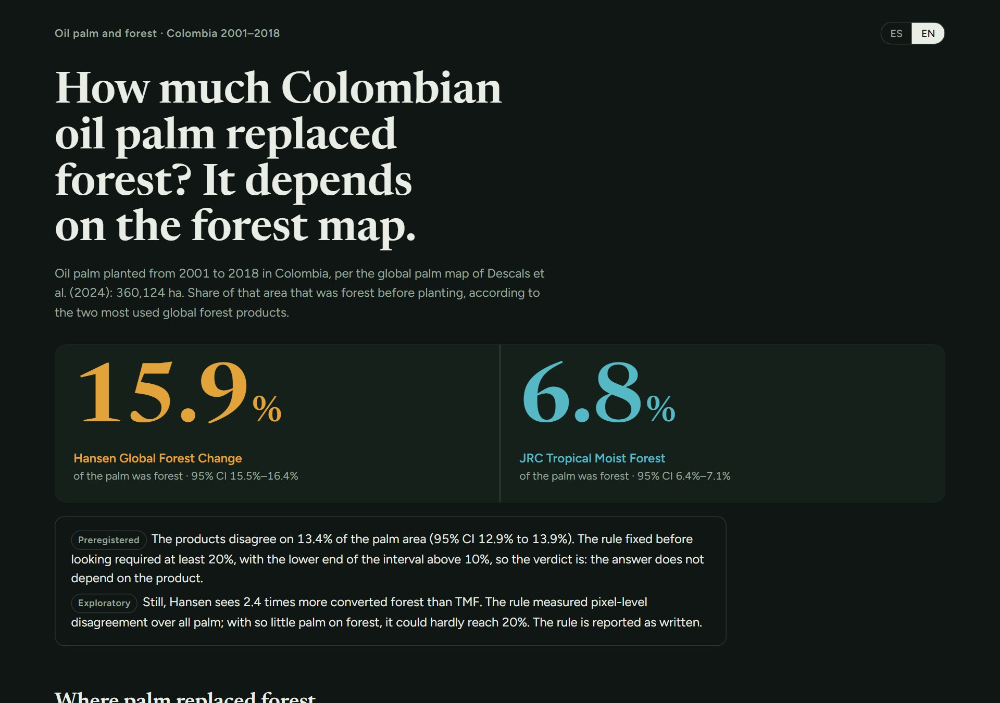

# Oil palm and forest in Colombia

How much of the oil palm planted in Colombia between 2001 and 2018 was forest before it was planted? The answer depends on which global forest map is asked, and this repository measures by how much. Hansen Global Forest Change and JRC Tropical Moist Forest (TMF) are applied, pixel by pixel, to the global oil palm planting-year map of Descals et al. (2024), under rules written down before any forest-loss value was read over palm ([PREREGISTRATION.md](PREREGISTRATION.md)).

**Dashboard: https://linaq11.github.io/palm-deforestation-colombia/** (English and Spanish)



*[Leer en español](#en-español)*

## Result

Oil palm planted from 2001 to 2018 in Colombia (LSIB outline): **360,124 ha** (wall-to-wall).

| Share of that palm that was forest before planting | Estimate | 95 % interval |
|---|---|---|
| According to Hansen | **15.9 %** | 15.5 to 16.4 |
| According to TMF | **6.8 %** | 6.4 to 7.1 |
| According to both | 4.6 % | 4.3 to 4.9 |
| Disagreement (exactly one product says forest) | 13.4 % | 12.9 to 13.9 |

Simple random sample of 20,000 palm pixels of 30 m, 2,000 bootstrap resamples. The wall-to-wall shares (16.0, 6.9, 4.8 and 13.4 %) fall inside every interval, which was the preregistered check that the sample and the code agree.

**Preregistered verdict.** The products were to be called in material disagreement if they disagreed on at least 20 % of the palm area with the lower end of the interval above 10 %. They disagree on 13.4 %, so under the rule fixed in advance **the answer does not depend on the product**. The stated expectation was met only in part: Hansen does give the higher share, but the disagreement is not material by that rule.

**Exploratory, not preregistered.** Hansen still finds 2.4 times as much converted forest as TMF in the sample (2.3 times wall-to-wall). The rule measured pixel-level disagreement over all palm, and with only about one palm pixel in six on former forest according to Hansen, it could hardly reach 20 %. The rule is reported as it was written.

### By type of grower, threshold and department

| | Hansen | TMF | Disagreement | Sample pixels |
|---|---|---|---|---|
| Industrial | 15.2 % | 6.3 % | 12.7 % | 15,612 |
| Smallholder | 18.8 % | 8.3 % | 16.1 % | 4,388 |
| Hansen tree cover ≥ 10 % instead of 30 % | 16.1 % | 6.8 % | 13.6 % | 20,000 |
| Hansen tree cover ≥ 50 % | 15.6 % | 6.8 % | 13.1 % | 20,000 |

By department (sample, at least 100 pixels, no intervals), Hansen gives 39 % in Norte de Santander, 29 % in Cundinamarca and 28 % in Santander, against 9 % in Meta, 5 % in Casanare and under 1 % in Vichada. TMF finds more than Hansen in two departments: Antioquia (19 % against 7 %, 293 pixels) and Córdoba (2.8 % against 1.4 %, 143 pixels). The full table is in [data/results_department.csv](data/results_department.csv).


### Three cells up close

The preregistration fixed how the detail areas would be chosen: on a 20 km grid, among the cells with at least 500 ha of palm (137 of them), the two with the most palm on forest according to both products and the two with the largest disagreement. The grid itself (EPSG:9377, cells aligned to its origin) was defined at implementation, after the national results were in. One cell is in both lists (second in the first, first in the second), so the rule gives three cells, next to each other in the Middle Magdalena.

| Cell | Municipality at the cell centre (FAO GAUL 2015) | Palm | Forest, both products | Disagreement |
|---|---|---|---|---|
| E4940_N2400 | San Alberto, Cesar | 6,785 ha | 2,035 ha | 1,510 ha |
| E4900_N2360 | Puerto Wilches, Santander | 8,408 ha | 1,915 ha | 2,714 ha |
| E4920_N2360 | Sabana de Torres, Santander | 10,785 ha | 1,064 ha | 2,397 ha |

In the dashboard each cell has a Landsat swipe (1999 to 2001 against 2022 to 2024), a planting-year slider and the palm pixels coloured by product.


## Rules

For a palm pixel with planting year Y (industrial or smallholder, Y from 2001 to 2018):

- **Hansen says forest** if tree cover in 2000 was at least 30 % and loss was recorded between 2001 and Y + 2.
- **TMF says forest** if the pixel was undisturbed or degraded forest in December 2000 and was recorded as deforested in some year from 2001 to Y + 2.

The two years after planting allow for error in the planting year. Both rules live in [src/palmforest/rules.py](src/palmforest/rules.py) and are tested on synthetic pixels with known histories (forest cleared then planted, pasture planted, old palm replanted, forest cleared ten years earlier, clearing after the margin, degraded forest, regrowth). Each rule was broken on purpose before the real run and a test failed each time, but that first round was not logged. After an audit showed that the tests did not pin the two-year margin or the exact threshold, boundary cases were added and the breaks were repeated and recorded in [tests/NEGATIVE_TESTS.md](tests/NEGATIVE_TESTS.md); the rules did not change.

## What it does not say

- Neither product is the truth. The comparison measures how much the answer moves with the forest map, not how much forest was really lost.
- The planting year is the last rotation. Old palm cleared and replanted can look like forest to Hansen, which counts tree cover and not forest type.
- The rules count loss only from 2001 (Hansen's loss record starts in 2001, and the TMF rule asks for forest in December 2000), so palm planted in the first years shows less forest by construction. The chart by planting year is not a trend. The preregistration justified the 2001 start by saying both products begin their loss record that year; that holds for Hansen but not for TMF, whose annual record goes back to 1990. The rule was kept as written.
- Hansen leaves the loss year empty where there was no loss, and the rules read it that way: 15,936 of the 20,000 sample pixels have it empty and none has 0 ([data/input_checks.json](data/input_checks.json)). The wall-to-wall check cannot test this, because both sides make the same reading.
- TMF maps tropical moist forest only. Palm on dry forest in the Caribbean cannot count as forest for TMF, which is one reason the results are given by department.
- It is not an assessment under the EU Deforestation Regulation, whose cut-off date is 31 December 2020.
- Three detail cells show 30 m palm pixels, which reveal the shape of plantations, as the satellite image does. There are no property boundaries, owners or companies anywhere in the repository.

## Reproduce

Needs an Earth Engine project with the API enabled (`earthengine authenticate` once). Commands are for a POSIX shell. To recompute the wall-to-wall sums from scratch, delete `data/cells_w2w.csv` first.

```bash
pip install -r requirements.txt
PYTHONPATH=src python -m pytest -q tests          # the rules on synthetic pixels
python scripts/tiled.py --project <ee-project>    # wall-to-wall sums (reused if data/cells_w2w.csv exists) and the sample
python scripts/analyze.py                         # estimates, intervals, decision rule -> data/results*.csv, results.txt
python scripts/grid20km.py --project <ee-project> # 20 km grid and the detail cells
python scripts/dashboard_data.py --project <ee-project>   # files read by docs/index.html
```

`tiled.py` runs everything on 0.5 degree cells. The first versions, `sample.py --export` and `wall_to_wall.py --export`, ran as single Earth Engine tasks over the whole country and timed out after about two hours; they are kept because `tiled.py` reuses their layers and rules. The change is recorded in the implementation note at the end of the preregistration, written before any result was seen. The pixel sample itself (`data/sample.csv`) is not in the repository; it is rebuilt by `tiled.py`.

## Data

| Layer | Earth Engine asset | Reference |
|---|---|---|
| Oil palm, type and planting year | `BIOPAMA/GlobalOilPalm/v1_2` | Descals, A., Gaveau, D. L., Wich, S., Szantoi, Z., Meijaard, E. (2024). Global mapping of oil palm planting year from 1990 to 2021. *Earth System Science Data* 16, 5111–5129. https://doi.org/10.5194/essd-16-5111-2024 |
| Hansen Global Forest Change | `UMD/hansen/global_forest_change_2025_v1_13` | Hansen, M. C., et al. (2013). High-resolution global maps of 21st-century forest cover change. *Science* 342, 850–853. https://doi.org/10.1126/science.1244693 |
| JRC Tropical Moist Forest | `projects/JRC/TMF/v1_2025/AnnualChanges` | Vancutsem, C., et al. (2021). Long-term (1990–2019) monitoring of forest cover changes in the humid tropics. *Science Advances* 7, eabe1603. https://doi.org/10.1126/sciadv.abe1603 |
| Country and departments | `USDOS/LSIB_SIMPLE/2017`, `FAO/GAUL/2015/level1` | |
| Imagery | Landsat 5, 7, 8 and 9, Collection 2 surface reflectance | |

---

## En español

¿Cuánta de la palma de aceite sembrada en Colombia entre 2001 y 2018 era bosque antes de la siembra? La respuesta depende del mapa de bosque que se consulte, y este repositorio mide cuánto. Hansen Global Forest Change y JRC Tropical Moist Forest (TMF) se aplican píxel a píxel sobre el mapa global de año de siembra de palma de Descals et al. (2024), con reglas escritas antes de leer cualquier valor de pérdida de bosque sobre palma ([PREREGISTRATION.md](PREREGISTRATION.md)).

**Resultado.** La palma sembrada entre 2001 y 2018 en Colombia (contorno LSIB) suma 360.124 ha. Según Hansen, el 15,9 % de esa área era bosque (IC 95 %: 15,5 a 16,4); según TMF, el 6,8 % (6,4 a 7,1). Los productos discrepan en el 13,4 % del área (12,9 a 13,9). El cálculo sobre toda el área cae dentro de los cuatro intervalos.

**Veredicto preregistrado.** La regla exigía un desacuerdo de al menos 20 %, con el límite inferior del intervalo por encima de 10 %, para hablar de discrepancia material. Con 13,4 %, el veredicto es que la respuesta no depende del producto. La expectativa declarada se cumplió solo a medias: Hansen sí da más que TMF, pero el desacuerdo no llega a ser material según la regla.

**Exploratorio.** Aun así, Hansen encuentra 2,4 veces más bosque convertido que TMF en la muestra (2,3 veces en el cálculo sobre toda el área). La regla medía desacuerdo píxel a píxel sobre toda la palma, y con cerca de un píxel de cada seis sobre lo que antes era bosque según Hansen, ese desacuerdo difícilmente llegaba a 20 %. Se reporta la regla tal como se escribió.

**Por departamento** (muestra, sin intervalos). Según Hansen, la palma sobre bosque es 39 % en Norte de Santander, 29 % en Cundinamarca y 28 % en Santander, contra 9 % en Meta, 5 % en Casanare y menos de 1 % en Vichada. TMF supera a Hansen en dos departamentos: Antioquia (19 % contra 7 %, 293 píxeles) y Córdoba (2,8 % contra 1,4 %, 143 píxeles). En los pequeños productores la proporción es mayor que en la palma industrial (18,8 % contra 15,2 % según Hansen).

**Celdas de detalle.** La regla preregistrada, aplicada a una grilla de 20 km que se definió al implementar, después de tener los resultados nacionales, dio tres celdas vecinas en el Magdalena Medio (San Alberto, Puerto Wilches y Sabana de Torres) porque una de ellas está en las dos listas. El dashboard las muestra con imágenes Landsat de 1999 a 2001 y de 2022 a 2024.

**Lo que no dice.** Ninguno de los dos productos es la verdad. El año de siembra corresponde a la última rotación. Las reglas solo cuentan pérdida desde 2001, así que los primeros años de siembra salen bajos por construcción. En Hansen, el año de pérdida vacío se lee como «sin pérdida». TMF solo cubre bosque húmedo tropical. No es una evaluación del reglamento europeo de deforestación (EUDR), cuya fecha de corte es el 31 de diciembre de 2020. En tres celdas se muestran píxeles de palma de 30 m, que dejan ver la forma de las plantaciones, igual que la imagen satelital; no hay linderos de predios, propietarios ni empresas.

## License

Code under the MIT License ([LICENSE](LICENSE)). The input datasets keep their own terms; the Earth Engine catalog lists the oil palm map and Hansen Global Forest Change under CC BY 4.0.
