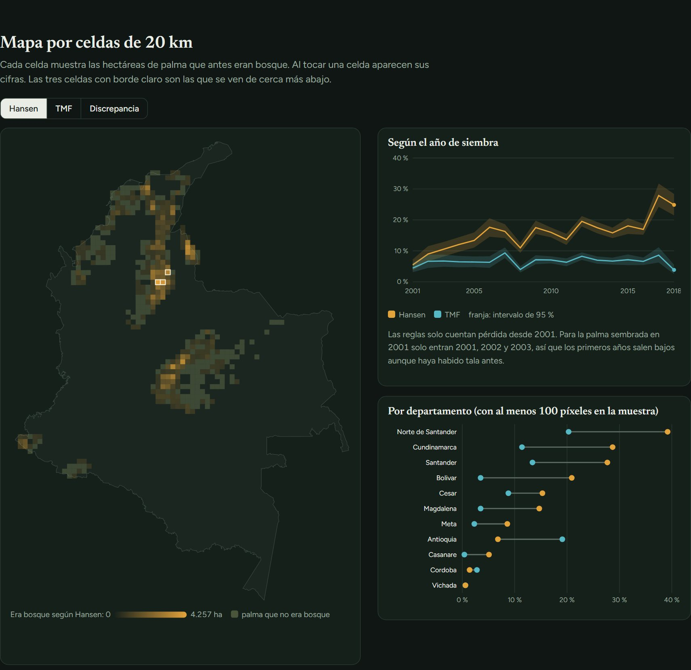
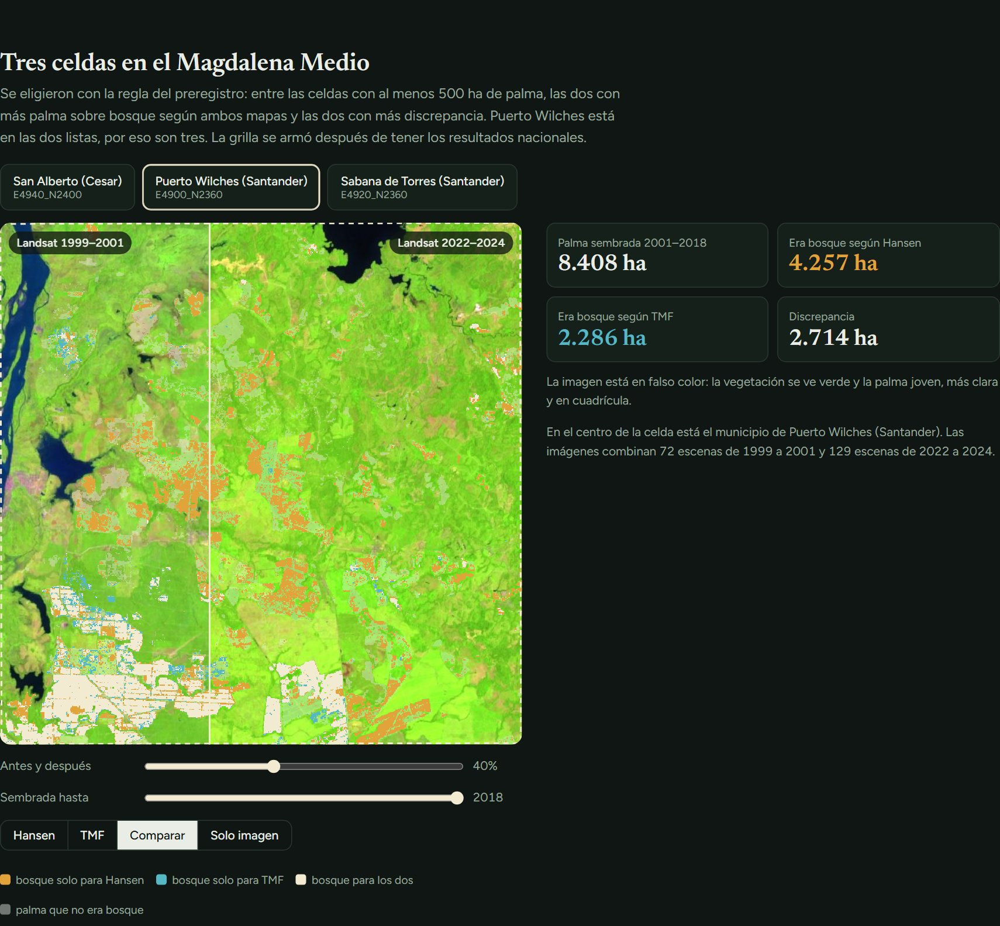

# Oil palm and forest in Colombia

Of the 360,124 ha of oil palm planted in Colombia from 2001 to 2018, 15.9 % was forest before planting according to Hansen Global Forest Change, and 6.8 % according to JRC Tropical Moist Forest (TMF). Both forest maps were applied pixel by pixel to the oil palm planting-year map of Descals et al. (2024), with rules written in [PREREGISTRATION.md](PREREGISTRATION.md) before any forest-loss value was read over palm.

Dashboard, in English and Spanish: https://linaq11.github.io/palm-deforestation-colombia/


[Español](#español)

## Results

| Palm planted 2001 to 2018 that was forest before planting | Estimate | 95 % interval |
|---|---|---|
| Hansen | **15.9 %** | 15.5 to 16.4 |
| TMF | **6.8 %** | 6.4 to 7.1 |
| Both | 4.6 % | 4.3 to 4.9 |
| Only one of the two | 13.4 % | 12.9 to 13.9 |

The estimates come from a simple random sample of 20,000 palm pixels of 30 m, with 2,000 bootstrap resamples. Computed over all palm pixels, the four shares are 16.0, 6.9, 4.8 and 13.4 %, each inside its interval.

The preregistration called the products in material disagreement if they disagreed on at least 20 % of the palm area, with the lower end of the interval above 10 %. They disagree on 13.4 %, so by that rule the answer does not depend on the product. Of the two expectations written beforehand, Hansen above TMF was met and material disagreement was not.

Outside the preregistration: Hansen's share is 2.4 times TMF's in the sample and 2.3 times over all pixels. With shares of 15.9 and 6.8 %, the disagreement could not have exceeded 22.7 %.

| | Hansen | TMF | Only one | Sample pixels |
|---|---|---|---|---|
| Industrial | 15.2 % | 6.3 % | 12.7 % | 15,612 |
| Smallholder | 18.8 % | 8.3 % | 16.1 % | 4,388 |
| Hansen tree cover ≥ 10 % instead of 30 % | 16.1 % | 6.8 % | 13.6 % | 20,000 |
| Hansen tree cover ≥ 50 % | 15.6 % | 6.8 % | 13.1 % | 20,000 |

In departments with at least 100 sample pixels, Hansen gives 39 % in Norte de Santander, 29 % in Cundinamarca and 28 % in Santander, against 9 % in Meta, 5 % in Casanare and under 1 % in Vichada. TMF is higher than Hansen in Antioquia (19 % against 7 %, 293 pixels) and Córdoba (2.8 % against 1.4 %, 143 pixels). Department figures have no intervals; the full table is [data/results_department.csv](data/results_department.csv).



## Detail cells

The preregistered rule picks, on a 20 km grid and among the 137 cells with at least 500 ha of palm, the two cells with the most palm on forest according to both products and the two with the largest disagreement. Puerto Wilches is in both lists, so there are three cells, next to each other in the Middle Magdalena. The grid (EPSG:9377) was defined after the national results were in.

| Cell | Municipality at the cell centre (FAO GAUL 2015) | Palm | Forest for both | Disagreement |
|---|---|---|---|---|
| E4940_N2400 | San Alberto, Cesar | 6,785 ha | 2,035 ha | 1,510 ha |
| E4900_N2360 | Puerto Wilches, Santander | 8,408 ha | 1,915 ha | 2,714 ha |
| E4920_N2360 | Sabana de Torres, Santander | 10,785 ha | 1,064 ha | 2,397 ha |

The dashboard shows each cell with Landsat composites from 1999 to 2001 and from 2022 to 2024, a planting-year slider and the palm pixels coloured by product.



## Method

For a palm pixel planted in year Y (industrial or smallholder, Y from 2001 to 2018):

- Hansen counts it as forest if tree cover in 2000 was at least 30 % and loss was recorded between 2001 and Y + 2.
- TMF counts it as forest if it was undisturbed or degraded forest in December 2000 and was recorded as deforested in some year from 2001 to Y + 2.

The two years after planting allow for error in the planting year. Both rules are in [src/palmforest/rules.py](src/palmforest/rules.py), with 18 tests on synthetic pixels of known history, including the exact edges of the two-year margin and the 30 % threshold. Deliberate breaks of the rules and the tests they tripped are listed in [tests/NEGATIVE_TESTS.md](tests/NEGATIVE_TESTS.md).

## Limitations

- No field data were used. The comparison shows how far the answer moves between two forest maps, not how much forest was lost.
- The planting year is the last rotation. Old palm cleared and replanted can count as forest for Hansen, which records tree cover and not forest type.
- Loss is counted only from 2001, so palm planted in the first years shows less forest by construction, and the chart by planting year is not a trend. The preregistration says both products start their loss record in 2001. That is true of Hansen; the TMF annual record starts in 1990.
- Hansen leaves the loss year empty where there was no loss, and it is read that way: 15,936 of the 20,000 sample pixels have it empty and none has 0 ([data/input_checks.json](data/input_checks.json)). The wall-to-wall check makes the same reading, so it cannot test it.
- TMF maps tropical moist forest only. Palm on dry forest in the Caribbean cannot count as forest for TMF.
- This is not an assessment under the EU Deforestation Regulation, whose cut-off date is 31 December 2020.
- The three detail cells show 30 m palm pixels. There are no property boundaries, owners or companies in the repository.

## Reproducing the analysis

An Earth Engine project with the API enabled is needed (`earthengine authenticate` once). The commands are for a POSIX shell.

```bash
pip install -r requirements.txt
PYTHONPATH=src python -m pytest -q tests          # rules on synthetic pixels
python scripts/tiled.py --project <ee-project>    # wall-to-wall sums and the sample
python scripts/analyze.py                         # estimates, intervals, decision rule
python scripts/grid20km.py --project <ee-project> # 20 km grid and detail cells
python scripts/dashboard_data.py --project <ee-project>   # files for docs/index.html
```

`tiled.py` works on 0.5 degree cells and reuses `data/cells_w2w.csv` if it exists; delete it to recompute the wall-to-wall sums. The single-task versions (`sample.py --export`, `wall_to_wall.py --export`) timed out in Earth Engine after about two hours. `tiled.py` reuses their layers and rules, and the change is noted at the end of the preregistration. `data/sample.csv` is not tracked and `tiled.py` rebuilds it.

## Data

| Layer | Earth Engine asset | Reference |
|---|---|---|
| Oil palm, type and planting year | `BIOPAMA/GlobalOilPalm/v1_2` | Descals, A., Gaveau, D. L., Wich, S., Szantoi, Z., Meijaard, E. (2024). Global mapping of oil palm planting year from 1990 to 2021. *Earth System Science Data* 16, 5111–5129. https://doi.org/10.5194/essd-16-5111-2024 |
| Hansen Global Forest Change | `UMD/hansen/global_forest_change_2025_v1_13` | Hansen, M. C., et al. (2013). High-resolution global maps of 21st-century forest cover change. *Science* 342, 850–853. https://doi.org/10.1126/science.1244693 |
| JRC Tropical Moist Forest | `projects/JRC/TMF/v1_2025/AnnualChanges` | Vancutsem, C., et al. (2021). Long-term (1990–2019) monitoring of forest cover changes in the humid tropics. *Science Advances* 7, eabe1603. https://doi.org/10.1126/sciadv.abe1603 |
| Country and departments | `USDOS/LSIB_SIMPLE/2017`, `FAO/GAUL/2015/level1` | |
| Imagery | Landsat 5, 7, 8 and 9, Collection 2 surface reflectance | |

## License

Code under the MIT License ([LICENSE](LICENSE)). The input datasets keep their own terms. The Earth Engine catalog lists the oil palm map and Hansen Global Forest Change under CC BY 4.0.

---

## Español

De las 360.124 ha de palma de aceite sembradas en Colombia entre 2001 y 2018, el 15,9 % era bosque antes de la siembra según Hansen Global Forest Change y el 6,8 % según JRC Tropical Moist Forest (TMF). Los dos mapas de bosque se aplicaron píxel a píxel sobre el mapa de año de siembra de Descals et al. (2024), con reglas escritas en el [preregistro](PREREGISTRATION.md) antes de leer cualquier valor de pérdida de bosque sobre palma.

Los intervalos de 95 % son 15,5 a 16,4 % para Hansen y 6,4 a 7,1 % para TMF. Los dos productos coinciden en que era bosque en el 4,6 % del área y discrepan en el 13,4 % (12,9 a 13,9). Se usó una muestra aleatoria simple de 20.000 píxeles y 2.000 remuestreos bootstrap. El cálculo sobre todos los píxeles cae dentro de los cuatro intervalos.

El preregistro fijaba un desacuerdo de al menos 20 %, con el límite inferior del intervalo por encima de 10 %, para hablar de discrepancia material. Con 13,4 %, la respuesta no depende del producto según esa regla. De las dos expectativas escritas de antemano, se cumplió que Hansen diera más que TMF y no se cumplió que el desacuerdo fuera material.

Fuera del preregistro, Hansen da 2,4 veces lo que da TMF en la muestra y 2,3 veces sobre todos los píxeles. Con 15,9 y 6,8 %, el desacuerdo no podía pasar de 22,7 %.

En los pequeños productores la proporción es mayor que en la palma industrial (18,8 % contra 15,2 % según Hansen). Por departamento, Hansen da 39 % en Norte de Santander, 29 % en Cundinamarca y 28 % en Santander, contra 9 % en Meta, 5 % en Casanare y menos de 1 % en Vichada. TMF da más que Hansen en Antioquia (19 % contra 7 %, 293 píxeles) y en Córdoba (2,8 % contra 1,4 %, 143 píxeles). Las cifras por departamento no tienen intervalos.

La regla preregistrada para las celdas de detalle, aplicada a una grilla de 20 km definida después de tener los resultados nacionales, dio tres celdas vecinas en el Magdalena Medio: San Alberto, Puerto Wilches y Sabana de Torres. Puerto Wilches está en las dos listas. El dashboard las muestra con imágenes Landsat de 1999 a 2001 y de 2022 a 2024.

No se usaron datos de campo, así que la comparación muestra cuánto cambia la respuesta entre dos mapas de bosque y no cuánto bosque se perdió. El año de siembra corresponde a la última rotación. La pérdida solo se cuenta desde 2001, por lo que los primeros años de siembra salen bajos por construcción. En Hansen, el año de pérdida vacío se lee como ausencia de pérdida. TMF solo cubre bosque húmedo tropical. No es una evaluación del reglamento europeo de deforestación (EUDR), cuya fecha de corte es el 31 de diciembre de 2020. Las tres celdas de detalle muestran píxeles de palma de 30 m, y en el repositorio no hay linderos de predios, propietarios ni empresas.
